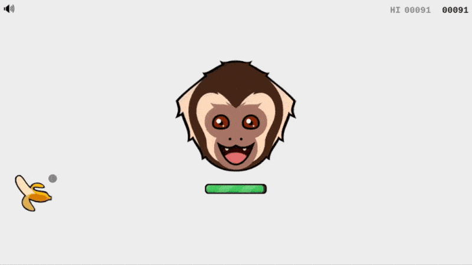

<h1 align="center">
  
</h1>

<em>A fast-paced reflex-based arcade clicker browser game built with vanilla JavaScript.</em>

  <a href="https://magicomick.github.io/please-the-monkey/"><strong>🎮 Play Live Demo</strong></a> ·
  <a href="#about">About</a> ·
  <a href="#how-to-play">How to Play</a> ·
  <a href="#built-with">Tools</a> ·
  <a href="#credits">Credits</a>

## About

Keep the monkey's patience bar from draining while items bounce around the screen, DVD-screensaver style. Designed, illustrated, and programmed as a self-taught first project in 3 weeks, with zero external libraries or frameworks.

## How to Play

| Action                   | Effect                                             |
| ------------------------ | -------------------------------------------------- |
| 🐵 Click the monkey      | `+5%` patience                                     |
| 🍌 Click a good banana   | `+40%` patience                                    |
| 🤢 Click a rotten banana | `-15%` patience                                    |
| 💩 Click poops           | Clear them before they speed up patience depletion |

The monkey reacts to its current patience level, the game works with mouse or touch, and high scores are saved locally.

## Built With

- **HTML5**, **CSS3** and **Vanilla JavaScript (ES6+)**
- **Figma** (vector art and SVG design)
- **Audacity** (audio editing)

## Known Bugs & Limitations

- **Input Latency:** Floating items may need an extra click, and a successful click can take a moment to show on the patience bar.
- **Viewport Boundary Collisions:** Bounce animations can occasionally overlap near the edges.

## Future Improvements

- **Collision Refactor:** Move item physics and boundary logic into class-based modules.
- **Game Balance:** Tune patience gain/loss against score progression.
- **Menus & Navigation:** Add a return-to-title option, a tutorial, and a credits menu.
- **UI/UX, Audio & Animations:** Add background art, feedback on items, particles, and monkey reaction animations.
- **Responsive Design:** Improve layout scaling and touch targets across screen sizes.
- **Sprite Colors:** Rework the red-heavy SVG sprites with a more balanced palette.

## Credits

- **Progress Bar UI:** Adapted from the [CSS-Tricks Progress Bars Guide](https://css-tricks.com/css3-progress-bars/).
- **Title Music:** _"[Digital Bananas](https://opengameart.org/content/digital-bananas)"_ by Locomule ([CC0](https://creativecommons.org/publicdomain/zero/1.0/)).
- **Game Music:** _"[Banana track](https://opengameart.org/content/banana-track)"_ by skrjablin ([CC0](https://creativecommons.org/publicdomain/zero/1.0/)).
- **Fonts:** _Irish Grover_ ([Apache License](http://www.apache.org/licenses/LICENSE-2.0)) and _Noto Sans Symbols 2_ ([SIL OFL](https://openfontlicense.org/open-font-license-official-text/)), both via Google Fonts.

## License

Licensed under [CC BY-NC-SA 4.0](https://creativecommons.org/licenses/by-nc-sa/4.0/) by **Matheus GB Freitas**: you may share and adapt this work with credit, for non-commercial purposes, under the same license. The game's name and branding remain the property of the author.

## Support the Creator ☕

If you enjoyed _Please the Monkey_ or found the code useful for your studies, consider supporting my journey:

